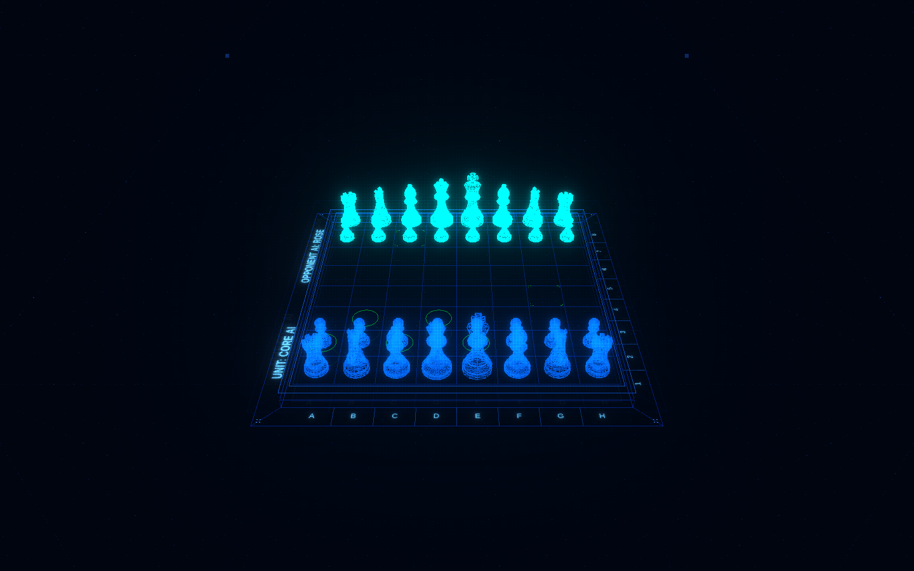
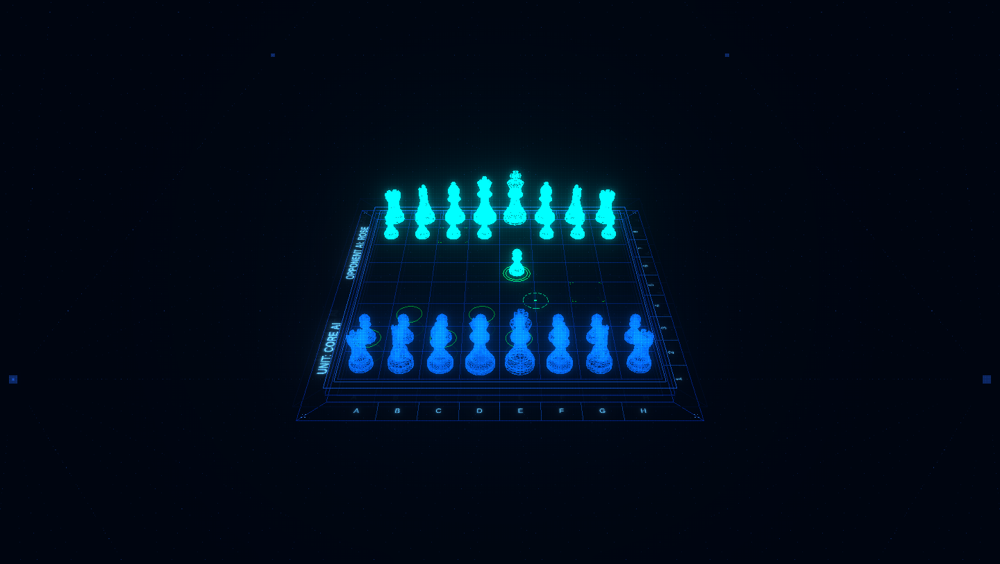

# Holographic 3D Chess

A browser chessboard drawn as a cyan wireframe on a dark starfield. Piece models are traced in neon linework, lit with bloom, and walked through a short scripted game: `e2-e4`, `e7-e5`, `Ng1-f3`, `d7-d5`, `e4xd5`, `d8xd5`. Drag to orbit the board. The camera stays above the table.



## Quick start

Requires Node.js 22.12 or newer.

```bash
npm install
npm run dev
```

Vite prints a local URL, usually http://localhost:5173. Add `?still=1` to hold the opening position instead of playing the line.

```bash
npm test
npm run build
npm run preview
```

`npm test` covers the square coordinates, the opening position, the scripted line and its captures, piece fitting, the lightning path, the move history, and the WebGL fallback.

## WebGL

The board needs WebGL 2. When the browser cannot create that context, the page shows a message in place of the canvas.

## Another moment from the line



The GitHub Pages workflow publishes the static `dist/` build from `master`.
